<h1 align="center">master_ws — Dynamic Obstacle Avoidance for a Mobile Robot</h1>

<p align="center">
  Autonomous 3D navigation for the <b>Innok Heros</b> rover — plan a path on a baked
  <b>Recast/Detour navigation mesh</b>, detect dynamic obstacles from live LiDAR,
  re-plan around them at runtime, and track the route with a pure-pursuit controller.
</p>

<p align="center">
  
  
  
  
  
  
</p>

<p align="center">
  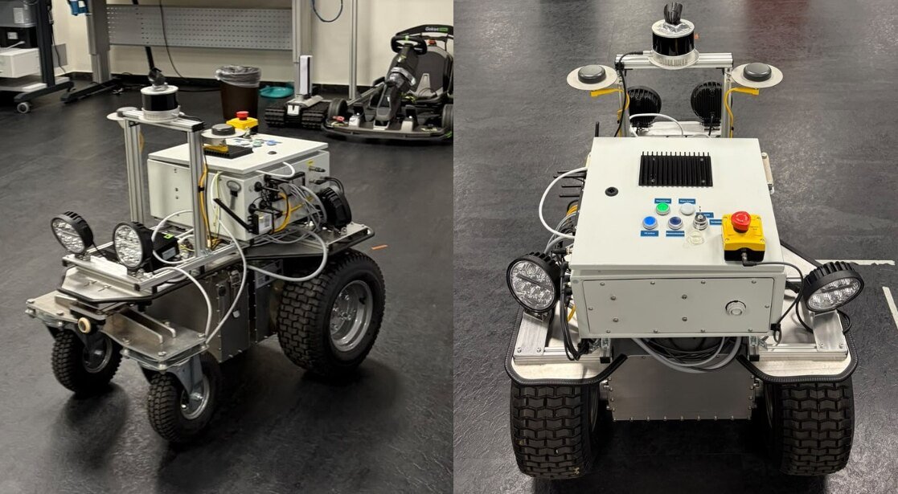
  <br>
  <sub><b>The Innok Heros rover</b> — Hesai Pandar LiDAR (top), ZED 2i stereo camera, and the Jetson Orin NX compute box.</sub>
</p>

Developed as a master's thesis (*Dynamic Obstacle Avoidance for Mobile Robot*,
Ilker Kurtulan, FH Dortmund — Embedded Systems Engineering). The rover takes a single
goal pose and autonomously plans a path across a pre-scanned indoor environment,
detects dynamic obstacles from live LiDAR, re-plans around them at runtime, and tracks
the resulting path — replacing an earlier manual, waypoint-based prototype with full 3D
NavMesh planning plus reactive obstacle avoidance. It is validated in **NVIDIA Isaac
Sim** and deployed on an **NVIDIA Jetson Orin NX** aboard the real rover.

<p align="center">
  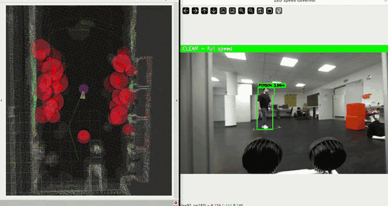
  <br>
  <sub><b>The whole system, live.</b> Left: the navigation mesh in RViz with dynamic obstacles carved as red cylinders and the planned path routed around them. Right: the ZED speed governor watching for people.</sub>
</p>

---

<details>
<summary><b>Contents</b></summary>

- [The idea](#the-idea) · [What the thesis delivers](#what-the-thesis-delivers) · [Robot platform](#the-robot-platform)
- [How it works](#how-it-works--the-basic-principle) · [Point cloud → map](#from-a-point-cloud-to-a-traversable-map) · [Architecture](#system-architecture) · [Inside the nodes](#inside-the-nodes) · [Sequence](#end-to-end-sequence)
- [Safety features](#safety-features) · [Field testing](#field-testing) · [Simulation](#simulation-validation) · [Footprint](#computational-footprint) · [Limitations](#limitations)
- **Reference:** [Setup & build](#environment-setup) · [Build a map](#build-your-own-map) · [Coordinate frames](#coordinate-frames) · [Running](#running-the-stack) · [Careful](#things-to-be-careful-about) · [Parameters](#key-parameters) · [Troubleshooting](#troubleshooting) · [Repo layout](#repository-layout)

</details>

---

## The idea

A previous research thesis built the base: **LiDAR-based indoor localization**, with a
human operator placing waypoints to drive the rover. There was **no dynamic obstacle
avoidance** while navigating.

This thesis removes the operator from the loop. One goal pose in, an autonomous,
collision-free route out — and when a person or object steps into the path, the rover
**re-plans around it on the fly**.

---

## What the thesis delivers

| | Objective | Result |
|---|---|---|
| **O1** | 3D navigation around the environment | Routes over ramps and multi-floor structures, not just flat ground |
| **O2** | Replace manual waypoints with obstacle-avoiding planning | One goal pose → autonomous routing with runtime re-planning |
| **O3** | Comparatively evaluate navigation approaches | One main approach (Recast/Detour NavMesh) assessed against alternatives |
| **O4** | Demonstrate and validate in sim **and** on real hardware | Validated in Isaac Sim, deployed on the Jetson Orin NX rover |

---

## The robot platform

| Component | Role |
|---|---|
| **Innok Heros** rover | Mobile base. Its onboard computer runs **ROS 1** and only serves LiDAR packets. |
| **Hesai Pandar XT16** | 3D LiDAR, 10 Hz — static-map construction and live obstacle detection. |
| **ZED 2i** stereo camera | Person detection for the human-aware speed governor. |
| **NVIDIA Jetson Orin NX** | Primary compute. Runs the full **ROS 2 Humble** stack (perception, planning, control). |
| **Simulation workstation** | Remote RTX workstation hosting Isaac Sim (via VNC). Runs *only* the simulator — the stack runs unchanged on the Jetson. |

The Innok base (ROS 1) and the Jetson (ROS 2) are bridged over one **direct Gigabit
Ethernet link** using two ZMQ channels:

- **LiDAR** — Innok → Jetson (`:5555`), republished on the Jetson as `/lidar/points`.
- **cmd_vel** — Jetson → Innok (`:5556`), driving the wheels.

See `cmd_vel_zmq_sender.py` (Jetson) and `cmd_vel_zmq_receiver_ros1.py` (Innok).

---

## How it works — the basic principle

The detector flags whatever is **not** on the static map; the planner carves those
obstacles into the navmesh as cylinders and re-plans; the controller follows the new
route — and once the obstacle leaves, the original path is restored.

<p align="center">
  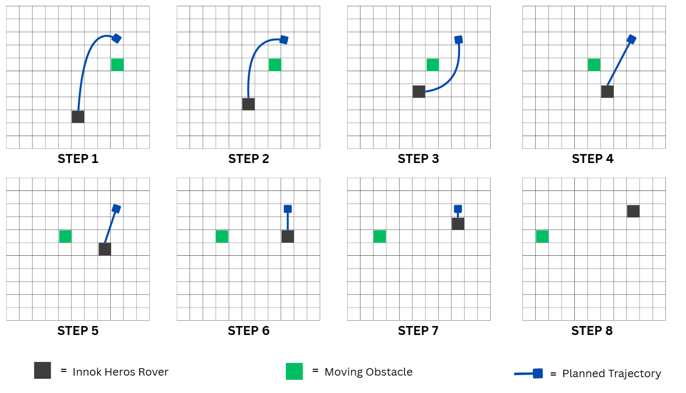
  <br>
  <sub><b>Routing around a moving obstacle (steps 1–8).</b> The planned trajectory (blue) bends away from the moving obstacle (green) and relaxes back to the direct route as the obstacle clears.</sub>
</p>

---

## From a point cloud to a traversable map

Two artifacts are produced **offline** from one handheld LiDAR scan: a **static
reference point cloud** for the detector and a **baked navigation mesh** for the
planner. The expensive work happens once; at runtime the planner searches only a few
hundred convex polygons — which is why it fits on embedded hardware.

```
   LiDAR scan            point cloud           voxel model           navigation mesh
    6.8 GB      ──►       1.1 M pts     ──►        98 k        ──►        24 KB
                                                                    ≈ 276,000× smaller
```

<p align="center">
  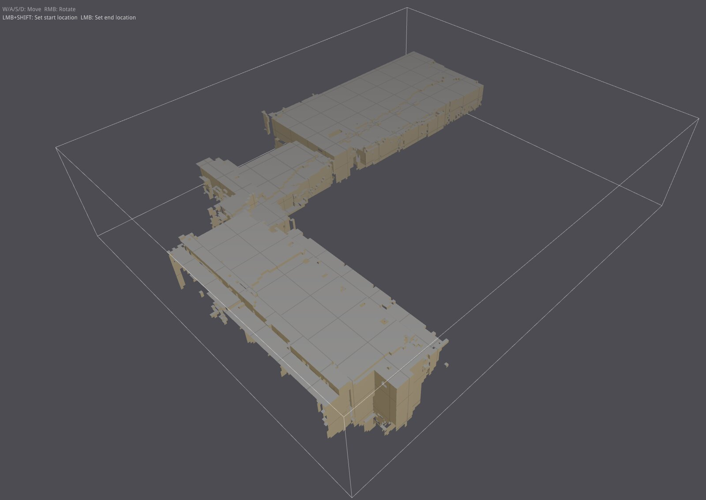
  &nbsp;
  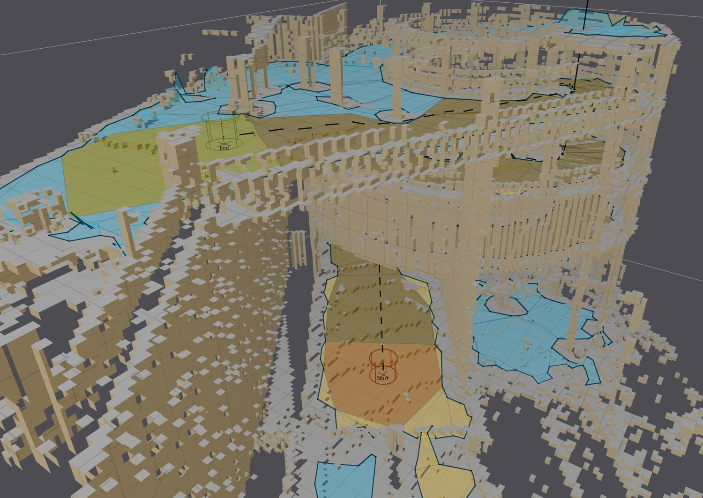
  <br>
  <sub><b>Left:</b> the baked navmesh — walkable floor and ramps only, split into the tiles <code>dtTileCache</code> regenerates at runtime. <b>Right:</b> an A* path (Start → End) across the voxelized building.</sub>
</p>

Two environments were mapped this way:

| Environment | Scan | Points | Voxels | Tiles | NavMesh |
|---|---|---|---|---|---|
| **BitLab** (lab) | 6.8 GB | 1.1 M | 98 k | 50 | 24 KB |
| **FH Underground Parking** | 10.7 GB | 1.5 M | 386 k | 219 | 68 KB |

> Want to map a new space? See [**Build your own map**](#build-your-own-map) in the reference below.

---

## System architecture

A **five-layer architecture** on ROS 2 Humble — each layer depends only on the one
below it:

| Layer | Responsibility | Where it lives |
|---|---|---|
| **Sensor** | Hesai Pandar LiDAR + ZED 2i stereo camera | Hardware + drivers |
| **Localization** | Real-time 6-DoF pose in the static map (LiDAR-based, NDT) | `lidar_localization_ros2` (external) → `/pcl_pose` |
| **Perception** | Dynamic obstacle detection by static-map voxel subtraction | `dynamic_obstacle_detector` |
| **Planning** | NavMesh path planning + runtime obstacle injection & re-planning | `navmesh_planner` |
| **Control** | Pure-pursuit path tracking + safety stops + human-aware speed cap | `drive_controller`, `zed_speed_governor` |

<p align="center">
  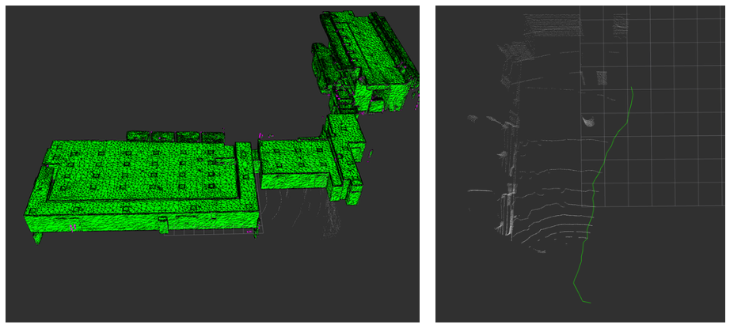
  <br>
  <sub><b>Five-layer architecture.</b> Each layer depends only on the one below it; the offline-baked navigation mesh and reference point cloud are the shared inputs.</sub>
</p>

---

## Inside the nodes

```
src/
├── dynamic_obstacle_detector/   # C++  — perception (voxel subtraction)
├── navmesh_planner/             # C++  — planning (Detour navmesh + tile cache)
├── drive_controller/            # C++  — control (pure pursuit + safety stops)
├── zed_speed_governor/          # Py   — person-aware speed cap
├── navmesh_gui/                 # Py   — operator interface (goal selection)
└── rover_bringup/               # one-command launch files: real robot + Isaac Sim
```

### `dynamic_obstacle_detector` (`voxel_subtraction_node`)
Subtracts a pre-baked static voxel map from each live LiDAR scan; whatever remains is
a dynamic obstacle.

```
dynamic_obstacles = live_scan_voxels − inflated_static_map_voxels
```

Load static PCD → voxelize (0.1 m) → inflate occupied voxels (XY and Z inflation are
separate) → per scan, transform to the map frame, apply Z-range + ground + self-filter,
subtract the inflated static set, apply temporal persistence, publish confirmed obstacles.

<p align="center">
  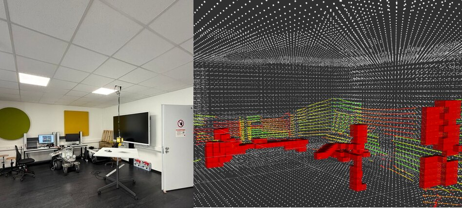
  <br>
  <sub><b>Perception.</b> Left: the physical BitLab space. Right: the live scan in RViz — everything matching the static map is subtracted away, leaving only the dynamic objects (red).</sub>
</p>

| Dir | Topic | Type |
|---|---|---|
| Sub | `/lidar/points` (real) or `/front_3d_lidar/lidar_points` (sim) | PointCloud2 |
| Sub | `/pcl_pose` (real) or `/chassis/odom` (sim) | PoseWithCovariance / Odometry |
| Pub | `/dynamic_obstacles_cloud` | PointCloud2 |
| Pub | `/dynamic_obstacles_markers` | MarkerArray (red cubes) |
| Pub | `/static_map_voxelized`, `/lidar_map_frame`, `/dynamic_candidates_cloud` | PointCloud2 (debug/alignment) |

### `navmesh_planner` (`navmesh_planner_node`)
Loads a pre-baked **Recast/Detour** navmesh and runs A* pathfinding. With a **tiled
(TSET)** navmesh it uses `dtTileCache` to carve dynamic obstacles as cylinders at
runtime and re-plan around them.

Pipeline: `findNearestPoly` (start + goal) → `findPath` (A* polygon corridor) →
`findStraightPath` (string-pull + funnel smoothing) → optional interpolation. Dynamic
obstacles are DBSCAN-clustered from `/dynamic_obstacles_cloud`, each cluster becomes a
cylinder injected via `addObstacle()` + `update()`, then the path is re-planned.

<p align="center">
  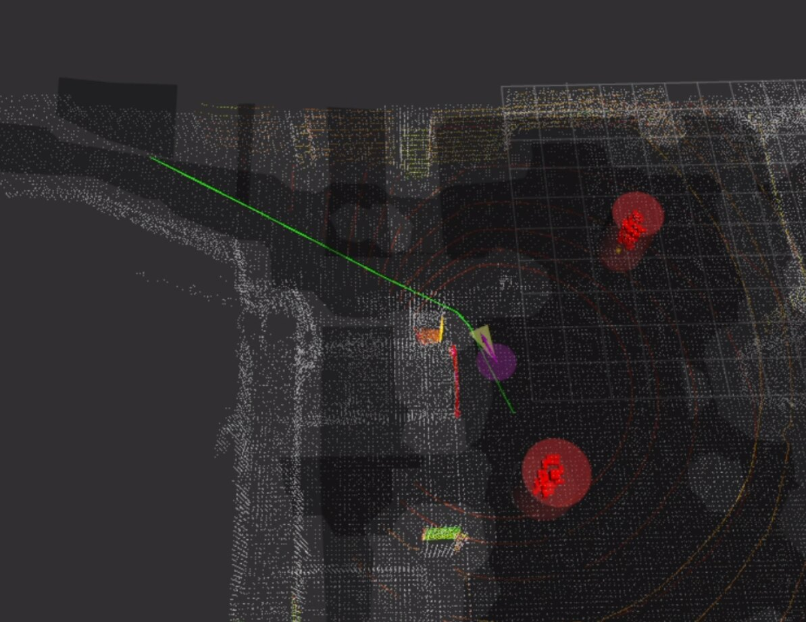
  &nbsp;
  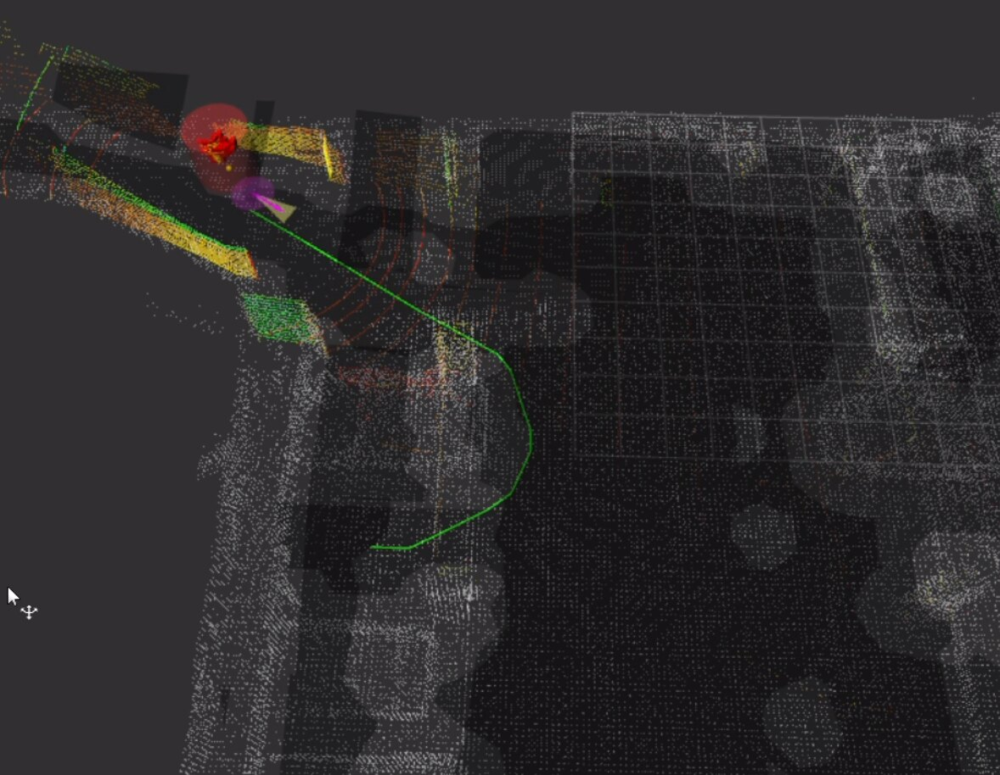
  <br>
  <sub><b>Live avoidance in RViz</b> — the planned path (green) bends around dynamic obstacles carved as cylinders (red) into the navigation mesh.</sub>
</p>

| Dir | Topic | Type |
|---|---|---|
| Sub | `/pcl_pose` | PoseStamped / PoseWithCovariance |
| Sub | `/goal_pose` | PoseStamped (RViz "2D Goal Pose" or the GUI) |
| Sub | `/dynamic_obstacles_cloud` | PointCloud2 (TSET only) |
| Sub | `/replan_request` | Bool |
| Pub | `/planned_path` | nav_msgs/Path |
| Pub | `/planned_path_markers`, `/navmesh_polys`, `/navmesh_obstacles_markers` | Marker(Array) |

Recast/Detour and FastLZ are **vendored as static libraries** under
`src/navmesh_planner/third_party/` — there is no external navigation dependency.

### `drive_controller` (`drive_controller_node`)
Pure-pursuit differential-drive follower of `/planned_path`. Speed-scaled lookahead,
pose-latency compensation, an omega low-pass, an acceleration ramp, a LiDAR safety
bubble with a bubble-escape state machine, a shy-away repulsion layer, and an external
`/speed_limit` cap.

| Dir | Topic | Type |
|---|---|---|
| Sub | `/pcl_pose`, `/planned_path`, `/dynamic_obstacles_cloud`, `/speed_limit` | — |
| Pub | `/cmd_vel`, `/replan_request`, `/lookahead_marker` | Twist / Bool / Marker |

### `zed_speed_governor` (`zed_speed_governor_node`)
Opens the ZED 2i, runs person detection, and if a person is inside a **forward gate**
(distance ≤ `gate_distance`, |lateral| ≤ `corridor_half_width`) publishes a reduced
`/speed_limit`; otherwise it publishes `-1.0` ("no limit"). **Fail-open:** a dead
camera means normal driving — the LiDAR safety bubble remains the real collision guard.

<p align="center">
  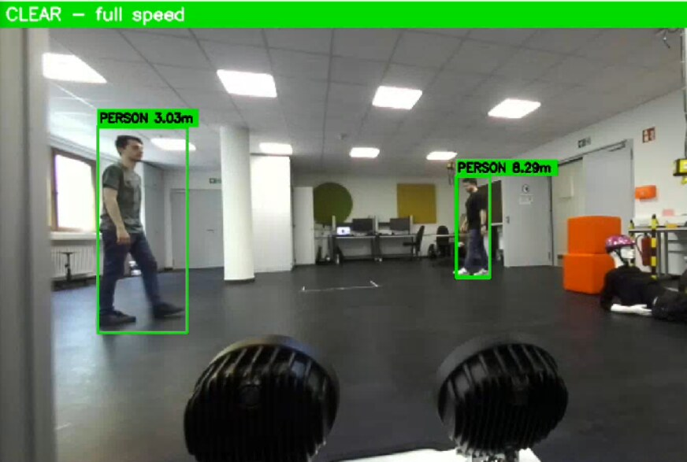
  &nbsp;
  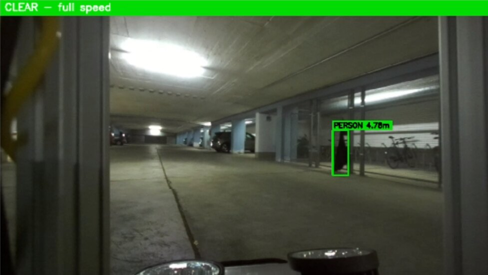
  <br>
  <sub><b>Speed governor operator view</b> — in the lab (left) and the parking garage (right). People are detected with their range (green boxes). Outside the forward gate the banner reads <code>CLEAR — full speed</code>; inside it, the speed is halved.</sub>
</p>

### `navmesh_gui`
Operator interface for selecting and publishing a goal pose, and for monitoring the
planned path / rover pose.

---

## End-to-end sequence

From a pedestrian stepping into the route to the detour, the speed cap, and the
recovery once the way is clear:

<p align="center">
  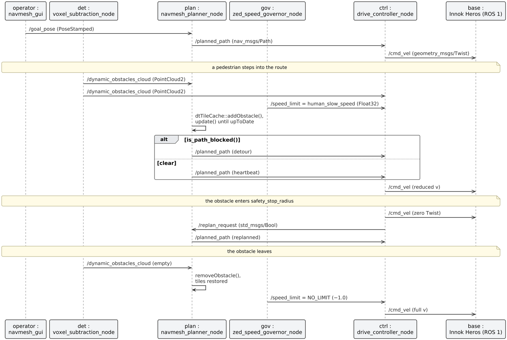
  <br>
  <sub><b>End-to-end sequence across all nodes</b> — detect → carve the obstacle into the navmesh → re-plan the detour, cap the speed, and recover the original route once the way is clear.</sub>
</p>

---

## Safety features

Three independent layers, ordered innermost-first, so a failure of one still leaves a
guard behind it:

- **Safety bubble** — a hard stop within a **0.5 m** radius of the rover (LiDAR-driven, always on).
- **Distance slowdown** — the rover eases off as it passes near any obstacle.
- **Camera speed cap** — the ZED speed governor halves the speed when a person is detected ahead, without altering the planned path.

<p align="center">
  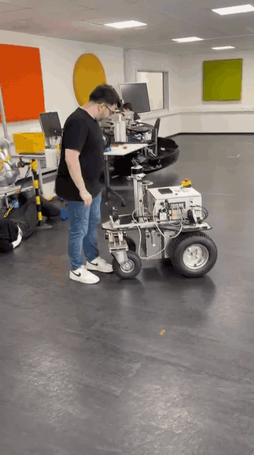
  &nbsp;
  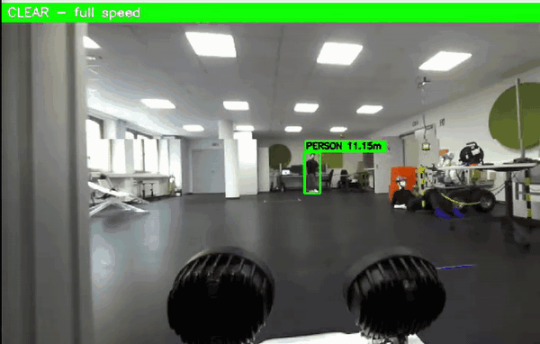
  <br>
  <sub><b>Left:</b> the 0.5 m safety bubble halts the rover. <b>Right:</b> the ZED governor tracks people and their distance to cap speed.</sub>
</p>

> During testing, occasional false detections traced back to a low ZED-SDK confidence
> threshold — tightened in the governor's configuration.

---

## Field testing

The integrated stack, running on the Jetson, in the two real environments.

<p align="center">
  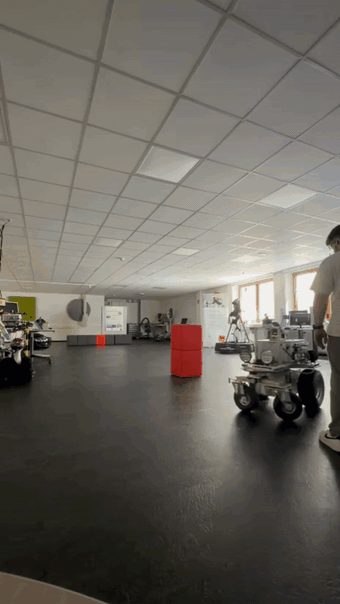
  &nbsp;
  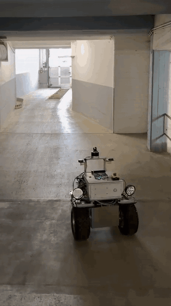
  <br>
  <sub><b>BitLab (left)</b> — avoiding boxes in the lab. <b>Underground parking (right)</b> — autonomous drive through the garage.</sub>
</p>

<p align="center">
  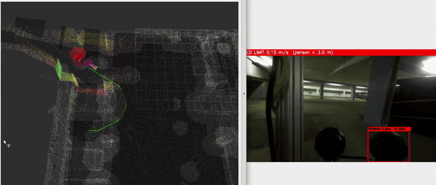
  <br>
  <sub><b>Operator dashboard during a parking-garage run</b> — the navmesh and planned path in RViz next to the live camera feed.</sub>
</p>

---

## Simulation validation

<p align="center">
  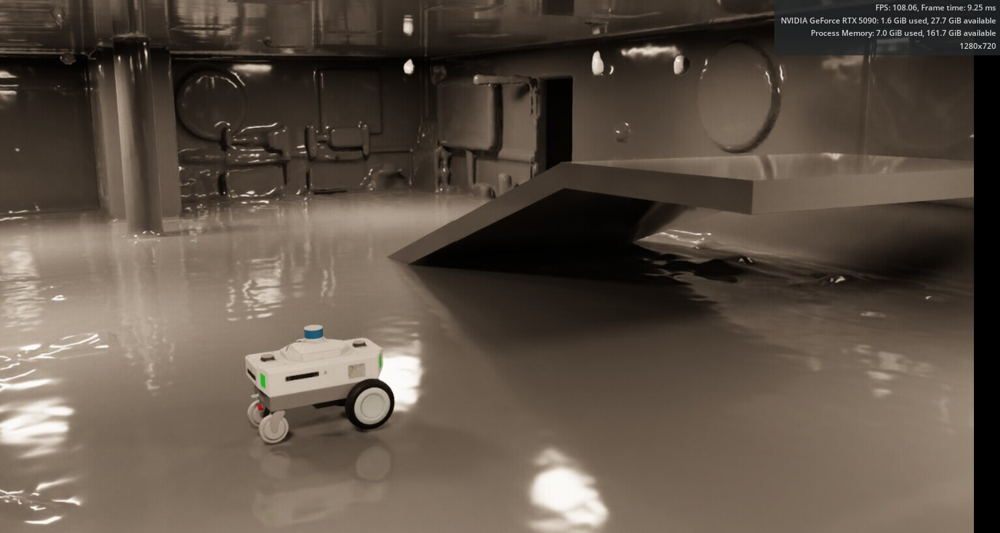
  <br>
  <sub><b>Isaac Sim.</b> The reconstructed environment is imported as a visual + collision scene; OmniGraph supplies ground-truth pose on <code>/chassis/odom</code>, so planning and avoidance are tested repeatably before real-world deployment.</sub>
</p>

---

## Computational footprint

Measured on the Jetson Orin NX at 10 Hz over a 180 s BitLab run, with a person
repeatedly entering and leaving the route and detection zone:

| Metric | Value | Of available |
|---|---|---|
| `navmesh_planner` CPU | **4.4 %** | of one core |
| Total RAM (all nodes) | **810 MB** | of 7.6 GB |
| Total CPU (all nodes) | **141 %** | of 800 % (8 cores) |

The whole stack — perception, planning, control and the camera governor — runs
comfortably within one embedded device.

---

## Limitations

Honest scope, for anyone building on this:

- **The map is static.** A car that parks *after* the scan stays a dynamic obstacle indefinitely; nothing promotes a persistent detection into the static map.
- **Obstacles are observed, not predicted.** Against something accelerating at high speed into the path, the system would fail.
- **Approaches were assessed, not fully benchmarked.** The comparison is a selection study: Nav2 is discussed (it cannot operate on 2.5D–3D navigation), and Mesh Navigation was tested but not run end-to-end.
- **No liveness check on perception.** The controller acts on the last obstacle message it received; a dead detector node is not detected.

---
---

# Reference

## Environment setup

### Prerequisites

- **Ubuntu 22.04** with **ROS 2 Humble** (the Jetson runs the same distribution under
  **JetPack 6**, so no cross-compilation is needed).
- **C++17** toolchain (GCC 11), `ament_cmake`, `rclcpp`.
- **PCL**, **tf2**, **Eigen** (the remaining third-party dependencies for the C++ nodes).
- **Python 3.10** with `rclpy` (operator interface, speed governor, bridge/conversion scripts).
- **Open3D** + NumPy (offline map preparation only).
- **ZED SDK 5.0.1** + `pyzed` (only for `zed_speed_governor`; the MEDIUM/NEURAL
  TensorRT engine is optimized once on first run and needs internet for that download).

> ⚠️ **Always `conda deactivate` before any ROS 2 work.** ROS 2 Humble requires the
> system Python 3.10 (`/usr/bin/python3`). A conda `base` environment (Python 3.13)
> silently breaks `ros2 launch` and colcon's Python discovery.

### Build

```bash
git clone git@github.com:ilkerkurtulan97/master_ws.git ~/master_ws
cd ~/master_ws
conda deactivate                      # use system Python 3.10
source /opt/ros/humble/setup.bash
rosdep install --from-paths src --ignore-src -r -y
colcon build --symlink-install
source install/setup.bash
```

Build a single package during development:

```bash
colcon build --packages-select navmesh_planner --symlink-install
```

> `--symlink-install` is important: **YAML and launch edits take effect on a node
> restart, no rebuild.** Only C++ source changes require `colcon build`. If conda is
> active and interferes with Python discovery, add
> `--cmake-args -DPython3_EXECUTABLE=/usr/bin/python3`.

### External components (real robot only)

These run alongside the stack but are not part of this repository:

- **Localization** — `lidar_localization_ros2`, built in its own workspace
  (e.g. `~/localization_ws`). It publishes `/pcl_pose` and the `hesai_tf` transform.
- **LiDAR bridge** — ZMQ sender on the Innok, receiver on the Jetson publishing
  `/lidar/points`.
- **cmd_vel bridge** — `cmd_vel_zmq_sender.py` on the Jetson and
  `cmd_vel_zmq_receiver_ros1.py` on the Innok. Run exactly **one** of each.

---

## Build your own map

Every environment needs exactly **two files**, both derived from the same LiDAR scan
and in the **same coordinate frame** as the pose topic:

| File | Used by | Purpose |
|---|---|---|
| `<scene>.tcbin` | `navmesh_planner` | Tiled Detour navmesh — *where the rover can drive*. Supports runtime obstacle carving. |
| `<scene>.pcd` | `dynamic_obstacle_detector` | Static reference point cloud — subtracted from each live scan to find dynamic objects. |

### Baking pipeline

```
                pcd_to_obj.py                 bake_tcbin.py
  scene.pcd ───────────────────► scene_yup.obj ───────────────────► scene.tcbin
             (voxelize @ 0.1 m,                (Recast build:
              exposed-face mesh,                heightfield → regions →
              Z-up → Y-up swap)                 contours → polys → TSET tiles)
```

- **`scripts/pcd_to_obj.py`** (written for this work) voxelizes the point cloud and
  emits a triangle mesh of only the *exposed* voxel faces, performing the
  **Z-up → Y-up** axis swap so the output is already in Detour's convention.
- **`bake_tcbin.py`** (from the `voxelize_navmesh` toolchain) runs the Recast pipeline
  and serializes a **tiled TSET** `.tcbin`.

Typical bake parameters (tune per scene / platform):

```bash
python3 bake_tcbin.py scene_yup.obj scene.tcbin \
  --cell-size 0.10 --cell-height 0.10 \
  --agent-radius 0.30 \        # rover half-width (Innok ≈ 0.35 m)
  --agent-max-climb 0.30 \     # raise for ramps/curbs; 0.15 misses ramp junctions
  --agent-max-slope 45 \
  --tile-size 32 --max-obstacles 128
```

The planner logs the tile count at startup:

```
[navmesh_planner] TSET NavMesh loaded: N tiles, dtTileCache active
```

A tile count that seems too low for the scene means **undercoverage** — usually a
simplified/holey source mesh, `--agent-max-climb` too low, or a missing/incorrect
Z-up handling. Use the full-geometry mesh, not a simplified collision hull.

### NavMesh formats

| | MSET (static) | TSET (dynamic) |
|---|---|---|
| Magic bytes | `'MSET'` | `'TSET'` |
| Dynamic obstacles | Not supported | Cylinders via `dtTileCache` |

The loader auto-detects the format. **Dynamic obstacle avoidance requires a TSET
navmesh.** MSET files plan static paths but log a warning that carving is unavailable.

---

## Coordinate frames

Detour is **Y-up**; ROS 2 is **Z-up**. Every position is converted, consistently,
via `include/navmesh_planner/coordinate_utils.hpp`:

```
ROS → Detour:  d.x = ros.x   d.y = ros.z   d.z = ros.y
Detour → ROS:  ros.x = d.x   ros.y = d.z   ros.z = d.y
```

A forgotten swap is the single most common source of silent bugs (paths through
walls, wrong floor, wildly offset positions). All topics use the `map` frame.

---

## Running the stack

Two parallel configuration profiles are maintained per package: **Isaac Sim** and
**real robot**. Switching profiles is a launch-file / YAML change only — no rebuild.

### Isaac Sim (validation)

```bash
ros2 launch rover_bringup isaac_sim.launch.py            # add gui:=true for the operator GUI
```

This starts the map→World static TF, the obstacle detector, RViz, the planner and the
drive controller, all on simulated time. Then press **Play** in Isaac Sim and set a
goal via RViz "2D Goal Pose" or the GUI.

- Isaac Sim odometry is published on **`/chassis/odom`** (the front-LiDAR world pose).
  All three sim nodes subscribe to it. **Do not use `/robotPose`** — leftover
  OmniGraph nodes leave it with conflicting publishers.
- **Do not run `lidar_pose_relay.py`** — it is superseded and adds a wrong
  `/robotPose` publisher.
- Stop any `world_pose_tf_relay.py` before launching (it double-parents `base_link`
  and breaks TF).

### Real robot (Jetson Orin NX)

Prerequisite: bring up the **network link** and the LiDAR and cmd_vel **bridges**
first (see [External components](#external-components-real-robot-only)).

```bash
source ~/localization_ws/install/setup.bash    # lidar_localization_ros2
source ~/master_ws/install/setup.bash
ros2 launch rover_bringup real_robot.launch.py
```

This starts localization (with `hesai_tf`), the obstacle detector, the planner, the
drive controller and the ZED speed governor, all with the `real_robot2` profile.

| Option | Effect |
|---|---|
| `localization:=false` | Skip localization, e.g. when it is already running in another terminal |
| `zed:=false` | Skip the ZED speed governor, e.g. when no camera is attached |

If the localization workspace is not sourced, the launch stops immediately with
`package 'lidar_localization_ros2' not found` rather than starting the stack without
a pose. Source it, or pass `localization:=false`.

The `real_robot2` profile uses `/pcl_pose` (NDT), `/lidar/points` (ZMQ bridge), and
`message_typ: PoseWithCovariance`. Ensure the cmd_vel ZMQ bridge is running with
exactly **one** receiver on the Innok and **one** sender on the Jetson.

The per-package launch files still work for starting nodes individually, e.g.
`ros2 launch navmesh_planner real_robot2.launch.py`.

### Pre-drive verification checklist

- [ ] `ros2 topic hz /lidar/points` ≈ 10 Hz (real) — see network note below.
- [ ] `ros2 topic echo /pcl_pose --once` — localizer producing a pose.
- [ ] Planner log: `TSET NavMesh loaded: N tiles` with N > 0.
- [ ] RViz `/navmesh_polys` covers the actual floor you scanned.
- [ ] RViz `/static_map_voxelized` aligns with walls/floor (no vertical offset).
- [ ] Detector diag with no obstacles present: `static_filt ≈ total` (near-zero residual).
- [ ] Set a 2D Goal → `/planned_path` appears; step in front → path re-plans around you.

---

## Things to be careful about

These are hard-won field lessons — violating them reintroduces known failures.

**Environment / build**
- `conda deactivate` before every ROS 2 command (Python 3.10 vs conda 3.13).
- `--symlink-install`: config/launch = restart only; C++ = rebuild. After a build,
  **relaunch** the node or it keeps the old params from `install/`.
- **Absolute paths in the YAML configs** (`navmesh_path`, `static_map_path`) must be
  updated for each machine — they are the first thing to break on a new deployment.

**Network (real robot)**
- The 10 Hz LiDAR depends on the **direct Gigabit cable** (a 100 Mb router drops it
  to ~4 Hz and degrades everything downstream). The **Innok side is not persistent** —
  after an Innok reboot, re-apply the network recovery and re-check
  `ros2 topic hz /lidar/points` ≈ 10 before testing.
- The cmd_vel receiver on the Innok **must** be started with
  `_connect_address:=tcp://<jetson-ip>:5556` or it silently connects to loopback.
- Exactly **one** cmd_vel receiver on the Innok and **one** sender on the Jetson.
- **Do not touch the Innok `enp3s0` interface** (Hesai LiDAR + emergency-stop path).

**Planner / safety tuning (invariants that must hold)**
- Safety-zone ordering must always be:
  `planner blind disc (obstacle_min_rover_dist 0.35) < safety bubble (safety_stop_radius 0.5) < detour clearance (cylinder_padding + bake agent radius ≈ 0.75) ≤ repulsion_radius (0.7)`.
  If the planner's blind disc grows *larger* than the safety bubble, the rover
  deadlocks nose-to-obstacle.
- `obstacle_replan_interval` (0.2 s) must stay **below** the drive controller's
  `obstacle_stop_cooldown` (1.0 s), so replan heartbeats keep the rover driving the
  avoidance route instead of stop-starting.
- `snap_vextent` must stay **≤ ~1.3**. The Bitlab navmesh has walkable polys on the
  floor *and* on ceiling beams / mezzanine; a large vertical snap window pulls the
  start/goal onto the ceiling ("path drawn on the ceiling").
- `path_block_clearance` must stay below the bake agent radius, or a freshly replanned
  path that skirts a carved hole re-triggers "blocked" every cycle.

**Perception**
- XY and Z inflation are **separate**. The floor is a static surface, so vertical
  inflation eats the bottom of every object standing on it — keep `inflation_radius_z`
  small (1) or short objects (e.g. a 45 cm box) get missed.
- Keep `activation_distance` modest (≈ 6 m on the real robot). Localization heading
  error displaces static points proportionally to range, producing phantom obstacles
  at long range.

---

## Key parameters

### `navmesh_planner`
| Parameter | Typical | Notes |
|---|---|---|
| `navmesh_path` | `…/scene.tcbin` | TSET required for dynamic obstacles. |
| `pose_topic` / `message_typ` | `/pcl_pose` / `PoseWithCovariance` | Sim: `/chassis/odom` / `Odometry`. |
| `snap_vextent` | 1.0 | Vertical snap half-extent; keep ≤ 1.3. |
| `cluster_tolerance` | 0.25 | DBSCAN distance for the dynamic cloud. |
| `obstacle_radius_default` | 0.55 | Minimum carved cylinder radius. |
| `cylinder_padding` | 0.35 | Detour standoff vs. corridor width trade-off. |
| `obstacle_max_radius` | 1.1 | Hard cap on a carved radius (mis-merge guard). |
| `obstacle_decay_s` | 0.6 | Evict a tracked obstacle this long after last seen. |
| `obstacle_replan_interval` | 0.2 | Replan/heartbeat throttle. |

### `drive_controller`
| Parameter | Typical | Notes |
|---|---|---|
| `lookahead_distance` / `lookahead_time` | 0.6–1.2 | Speed-scaled lookahead. |
| `max_linear_speed` | 0.4–0.5 | Reduce for first real-world tests. |
| `safety_stop_radius` | 0.5 | Hard LiDAR safety bubble. |
| `repulsion_radius` / `repulsion_gain` | 0.70 / 2.0 | Shy-away layer. |
| `pose_latency` / `omega_smoothing_tau` | 0.20 / 0.15 | Latency comp. + jitter filter. |
| `speed_limit_timeout` | 1.0 | Fresh, non-negative `/speed_limit` caps speed. |

### `dynamic_obstacle_detector`
| Parameter | Sim | Real | Notes |
|---|---|---|---|
| `voxel_size` | 0.1 | 0.1 | Voxel resolution. |
| `activation_distance` | 10.0 | 6.0 | Long range → phantoms on the real robot. |
| `inflation_radius` / `inflation_radius_z` | 2 | 3 / 1 | XY vs Z absorb are independent. |
| `min_consecutive_scans` | 1 | 2 | Sim QT128 publishes partial slices → 1. |
| `ground_filter_height` | −2.0 | −2.5 | Relative to robot Z; must clear the floor. |
| `self_filter_*` | — | on | Sensor-frame chassis box (real robot only). |

### `zed_speed_governor`
| Parameter | Typical | Notes |
|---|---|---|
| `gate_distance` | 2.0 | Forward trigger distance for a person. |
| `corridor_half_width` | 1.0 | Someone to the side does not trigger. |
| `human_slow_speed` | 0.2 | Speed cap while triggered (detour-crawl). |
| `hold_time` | 1.2 | Hold after last detection; keep ≥ 1.0 s. |

---

## Troubleshooting

| Symptom | Likely cause | Fix |
|---|---|---|
| `findNearestPoly failed for start/goal` | Pose off the navmesh, or snap window too small | Increase `snap_vextent` (≤ 1.3) or re-localize |
| Path drawn on the ceiling | `snap_vextent` too large | Lower to ~1.0 |
| Path planned but rover doesn't move | `message_typ` mismatch across configs | Align `message_typ` in all nodes |
| Dozens of phantom obstacles | Long `activation_distance` + localization drift | Lower `activation_distance`, raise `inflation_radius` |
| Short object (≈45 cm) missed | Vertical inflation eating its base | Lower `inflation_radius_z` to 1 |
| Rover stops right in front of a box | Safety-zone ordering violated | Keep `obstacle_min_rover_dist` < `safety_stop_radius` |
| Left/right path flapping / "wiggle" | Replan feedback loop / pose latency | Epoch re-arm + speed-scaled lookahead (already in) |
| Navmesh has floor but no ramp | `--agent-max-climb` too low at bake time | Re-bake with `--agent-max-climb 0.30`+ |
| LiDAR at ~4 Hz | Traffic going through the router | Restore the direct Gigabit link |
| No detector output, `static_filt ≈ total` | No dynamic object present (correct) | Place/observe a real dynamic object |

---

## Repository layout

```
master_ws/
├── src/
│   ├── dynamic_obstacle_detector/   # voxel_subtraction_node (C++)
│   ├── navmesh_planner/             # navmesh_planner_node (C++) + third_party/ (Detour, DetourTileCache, fastlz)
│   ├── drive_controller/            # drive_controller_node (C++)
│   ├── zed_speed_governor/          # governor_node (Python)
│   ├── navmesh_gui/                 # operator interface (Python)
│   └── rover_bringup/               # real_robot.launch.py + isaac_sim.launch.py
├── scripts/
│   ├── pcd_to_obj.py                # PCD → Y-up OBJ (navmesh baking, step 1)
│   └── lidar_pose_relay.py          # (legacy; do not run in the current architecture)
├── docs/                            # README images and GIFs
├── cmd_vel_zmq_sender.py            # Jetson → Innok cmd_vel bridge
├── cmd_vel_zmq_receiver_ros1.py     # Innok-side ROS 1 cmd_vel receiver
└── data/, src/navmesh_planner/data/ # baked navmeshes (.tcbin) + reference clouds
```

Each package keeps its scene/platform parameters in `config/*.yaml` and a matching
`launch/*.launch.py`. Two profiles are maintained: Isaac Sim and real robot
(`real_robot2_*`). Large runtime artifacts (`build/`, `install/`, `log/`, some map
files) are git-ignored.

---

*Claude Opus 4.8 and 5.0 is used to develop and integrate parts of the code.*
